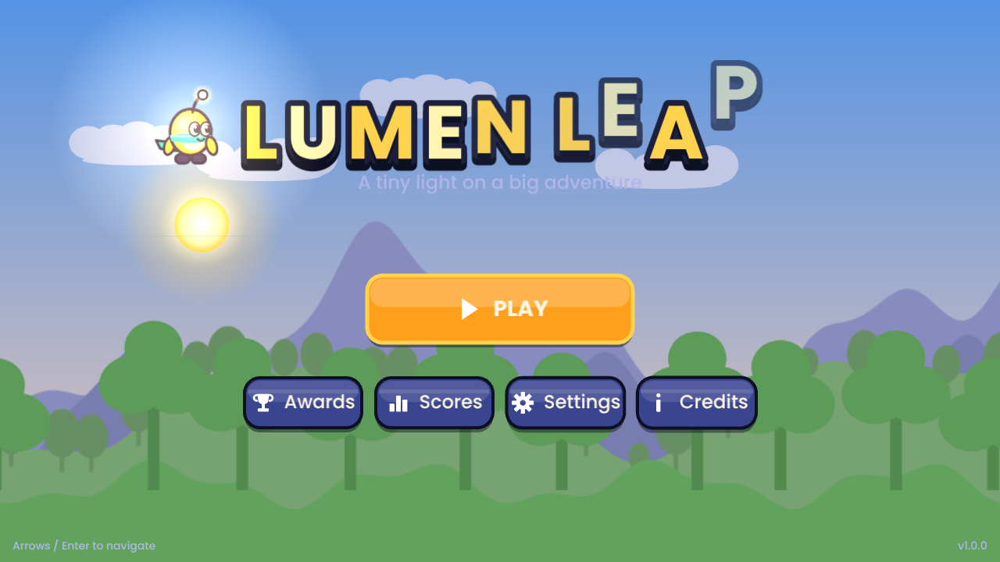
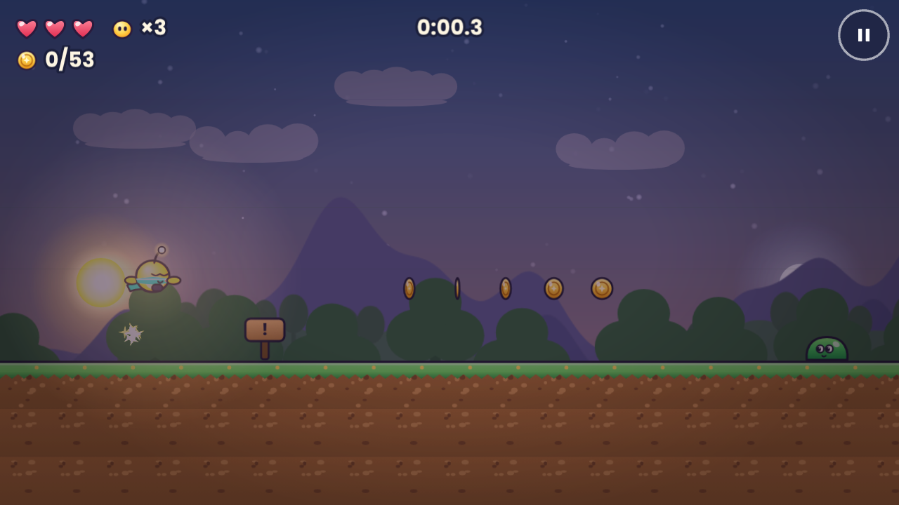

# Lumen Leap

A polished 2D platformer about Lumi, a tiny star-sprite racing from sunrise to midnight. Six handcrafted
levels, two boss fights, a living day/night sky — and one codebase that ships to **Web, Windows, macOS,
Android and iOS**.

Built with **Phaser 3 + TypeScript + Vite**, wrapped with **Capacitor** (mobile) and **Electron** (desktop).
Every sprite, tile, background, song and sound effect is generated in code, so the game has no art or
audio licensing to worry about (see [ATTRIBUTION.md](ATTRIBUTION.md)).




## Features

| | |
|---|---|
| **Movement** | Run, sprint, variable-height jump, double jump, wall slide & wall jump, drop through one-way platforms. Coyote time + jump buffering for responsive controls. |
| **World** | 6 levels across 5 themes (meadow, forest, cliffs, caves, storm), checkpoints, spikes, one-way platforms, crates. |
| **Enemies** | Slimes (stompable), spiky beetles (don't stomp!), swooping bats. |
| **Bosses** | **The Slime King** (leaps, shockwaves, summons minions) and **The Storm Golem** (rock barrages, slam + stun window, orb shockwaves). Both get angrier at half health. |
| **Systems** | Health (3 hearts) + lives, coins, 5 power-ups (heart, shield, speed boots, coin magnet, 1-Up), score, 3 stars per level, par times. |
| **Progress** | 3 save slots, autosave at checkpoints, resume-from-checkpoint, export/import save codes, 14 achievements, per-level top-10 leaderboards. |
| **Visuals** | Animated sprites with squash & stretch, particles, parallax, dynamic day/night lighting that changes as you move through a level, weather (leaves, fireflies, cave dust, rain + lightning), smooth camera with look-ahead, menu & scene transitions. |
| **Audio** | Web Audio engine with 5 original music tracks and 23 synthesized SFX, master/music/effects volume, mute. |
| **Controls** | Keyboard (WASD/arrows, Space, Shift, Esc), gamepad (standard mapping), touch (floating joystick + JUMP/RUN buttons, adjustable size). Menus are fully keyboard/gamepad navigable. |
| **Accessibility** | Screen shake & flash toggle, particle quality, button size, FPS counter, haptics toggle. |

## Quick start

```bash
git clone https://github.com/jaineil32624/lumen-leap.git
cd lumen-leap
npm install
npm run dev          # http://localhost:5173  (also reachable from your phone on the same Wi-Fi)
```

Open the folder in **VS Code** — recommended extensions, launch configs (`Debug game in Chrome`,
`Debug Electron main`) and tasks are included in `.vscode/`.

## Controls

| Action | Keyboard | Gamepad | Touch |
|---|---|---|---|
| Move | A / D or ← / → | Left stick / D-pad | Joystick (left half) |
| Jump / double jump / wall jump | Space, W, ↑ or Z | A or B | JUMP (or tap right half) |
| Sprint | Shift | X, Y, RB or RT | Hold RUN |
| Drop through platform | ↓ + Jump | Down + A | Joystick down + JUMP |
| Pause | Esc or P | Start | ⏸ button (top-right) |

## Scripts

| Command | What it does |
|---|---|
| `npm run dev` | Dev server with hot reload |
| `npm run build` | Typecheck + production web build → `dist/` |
| `npm run preview` | Serve the production build locally |
| `npm test` | Unit tests (Vitest) |
| `npm run lint` / `npm run format` | ESLint / Prettier |
| `npm run android:open` / `android:release` | Sync to Android Studio / build signed AAB + APK |
| `npm run ios:open` | Sync and open in Xcode |
| `npm run electron:dev` | Run the desktop app |
| `npm run dist:win` / `dist:mac` | Build Windows installer / macOS DMG |
| `npm run assets:icons` | Regenerate all native icons & splash screens from `resources/` |

## Documentation

- [docs/SETUP.md](docs/SETUP.md) — installing tools for each platform
- [docs/BUILD.md](docs/BUILD.md) — building web, desktop, Android and iOS
- [docs/DEPLOYMENT.md](docs/DEPLOYMENT.md) — GitHub Pages, itch.io, Google Play, App Store, desktop releases
- [docs/ARCHITECTURE.md](docs/ARCHITECTURE.md) — how the code is organised and how to extend it
- [docs/TESTING_CHECKLIST.md](docs/TESTING_CHECKLIST.md) — manual QA checklist before a release
- [store/](store/) — privacy policy and store listing templates
- [ATTRIBUTION.md](ATTRIBUTION.md) · [CONTRIBUTING.md](CONTRIBUTING.md) · [CHANGELOG.md](CHANGELOG.md)

## Project structure

```
src/
  main.ts                 Phaser config + global wiring
  config/constants.ts     All tuning numbers (physics, player feel, scoring, colours)
  core/                   Engine-independent systems: save, audio, achievements, leaderboard, input, events
  entities/               Player, enemies, bosses
  gfx/                    Procedural art (art/*), texture factory, effects, sky model
  levels/                 Level data (ASCII maps), parser, world builder
  scenes/                 Boot, Background, Game, UI (HUD), menus and overlays
  ui/                     Buttons, focus navigation, sliders, touch controls, theme
tests/                    Vitest unit tests
electron/                 Desktop shell (main + preload)
scripts/                  Native config patcher, icon renderer, level design helper
resources/                Source icon + splash for @capacitor/assets
public/                   Fonts, PWA manifest, service worker, web icons
store/                    Privacy policy + store listing templates
.github/workflows/        CI, GitHub Pages deploy, tagged release builds
```

## License

Code: [MIT](LICENSE) © 2026 Jaineil Rana. Poppins font: SIL OFL 1.1 (see [ATTRIBUTION.md](ATTRIBUTION.md)).
