<div align="center">

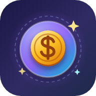

# 💰 Money Click — *premium idle clicker*

**Click, combo and crit your way from a humble farm to interdimensional portals.** Catch golden coins, hit business milestones, unlock 24 goals and prestige for investors. Your empire keeps earning while you're away. 🌙

> 📁 Money Click lives in the **`Platformer`** repo — the web app is `index.html` at the root.

[](https://jaineil32624.github.io/Platformer/)
[](https://github.com/jaineil32624/Platformer/releases/latest/download/MoneyClick.apk)
[](https://github.com/jaineil32624/Platformer/releases/latest)


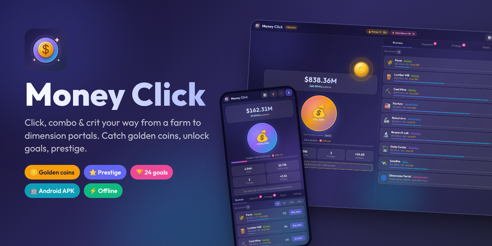

</div>

---

## ✨ Features

| | Feature | What it does |
|---|---|---|
| 👆 | **Click, combo, crit** | Click fast to build a 50-hit combo (up to +250% per click). Combos raise your crit chance; crits pay ×3 or more with a flash and a shake |
| ✨ | **Golden clicks** | A rare lucky click pays ×50 with a big gold burst |
| 🪙 | **Golden coins** | A shiny coin pops up every minute or two. Catch it for *Lucky* cash, a *Frenzy* (production ×7) or a *Click Storm* (clicks ×10) |
| 🏭 | **9 businesses** | Farm → Lumber Mill → Coal Mine → Factory → Robot Arm → Research Lab → Data Center → Satellite → Dimension Portal |
| 🎯 | **Milestones** | Owning 25 / 50 / 100 / 200… of a business **doubles** its output, shown right on the row |
| 🛒 | **Buy ×1 / ×10 / ×100 / Max** | Bulk-buy with exact geometric pricing, plus *Buy all affordable* upgrades |
| 🧰 | **20 upgrades** | Click multipliers, per-business boosts, Lucky Gloves (crit), Combo Keeper, Golden Touch (clicks earn a % of $/s), Gold Magnet |
| 🏆 | **24 goals with toasts** | Every unlocked goal pops a toast and gives **+2% to everything** |
| ⭐ | **Prestige** | Cash out for investors (√ lifetime ÷ $1M), each worth +5% forever. Progress bar to the next investor |
| 🌙 | **Offline earnings** | Autosaves every 10s. When you come back, a *Welcome back* card pays 50% of your income for up to 8h |
| 📈 | **Market events** | Investor visits, market surges and the occasional crash keep things lively |
| 📊 | **Stats panel** | Best click, best combo, crits, coins caught, peak money, time played and more |
| 🔢 | **Number formats** | $1.23K → M → B → T → Qa… or scientific `1.23e15` |
| 💾 | **Export / import saves** | Move your empire between devices with a save code. Old saves from the first version load automatically |
| 🔊 | **Synth sound & music** | Click pops that rise with your combo, crit zings, coin chimes, all made with the Web Audio API (no audio files). Mute with `M` |
| ⌨️ | **Keyboard friendly** | `Space` click · `1`–`5` tabs · `B` buy amount · `U` buy all upgrades · `G` grab coin · `S` stats · `M` mute · `?` help |
| 📱 | **Full-screen & responsive** | Fills any screen: two columns on desktop, a scrolling layout on phones with sticky tabs |

## 📸 Screenshots

<table>
<tr>
<td>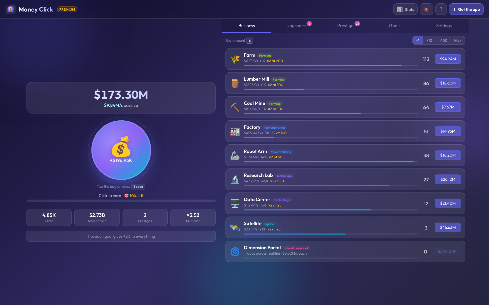<p align="center">💰 <b>Your empire</b>: combo bar, crits, milestones</p></td>
<td>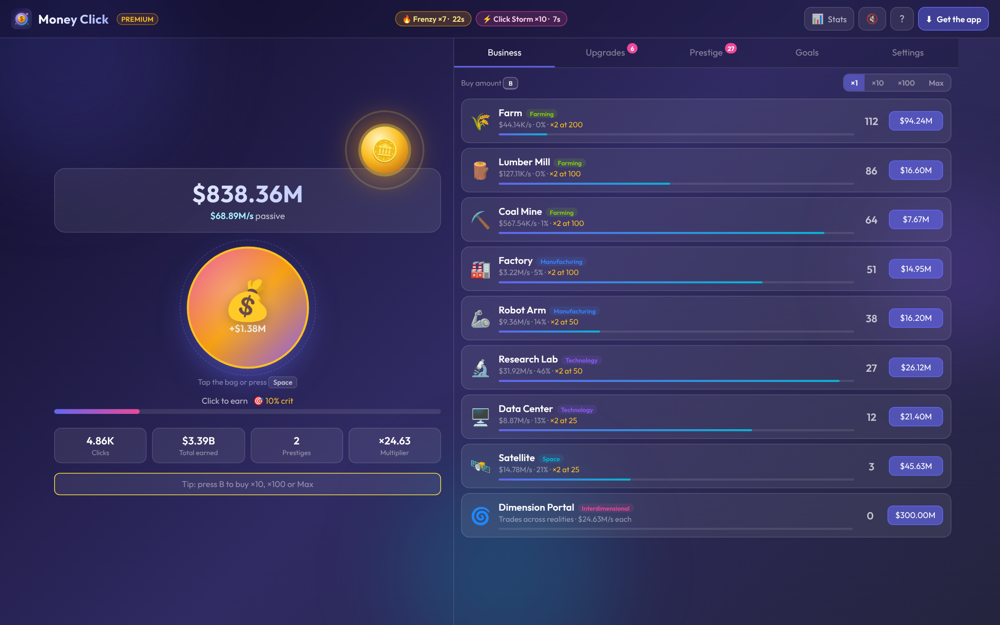<p align="center">🪙 <b>Golden coin</b> + Frenzy & Click Storm buffs</p></td>
</tr>
<tr>
<td>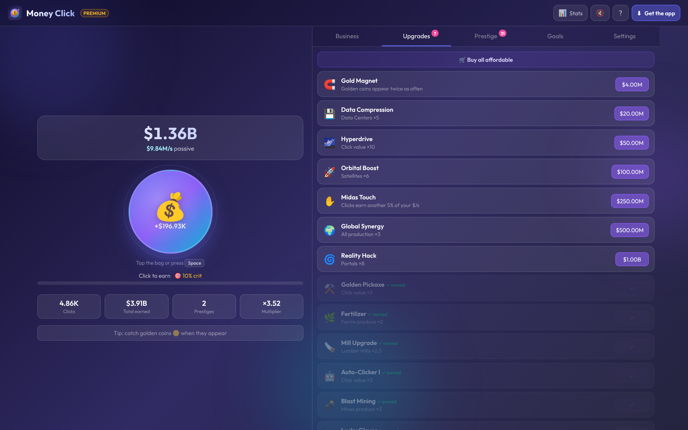<p align="center">🧰 <b>Upgrade shop</b> with <i>Buy all</i></p></td>
<td>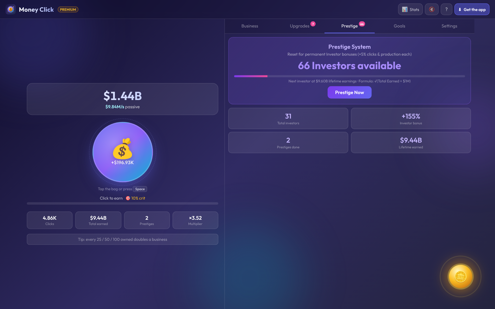<p align="center">⭐ <b>Prestige</b> for permanent investors</p></td>
</tr>
<tr>
<td>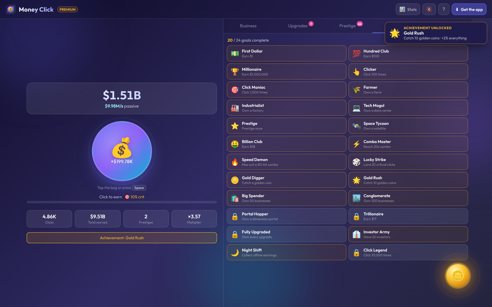<p align="center">🏆 <b>24 goals</b> with unlock toasts</p></td>
<td>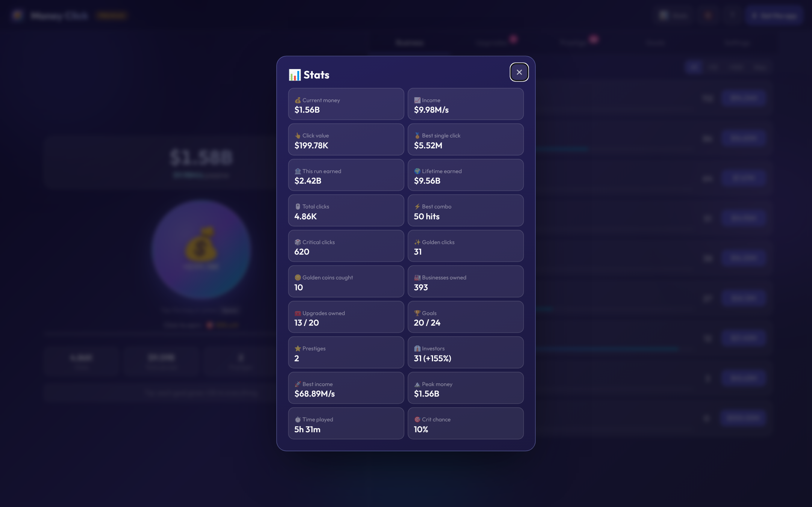<p align="center">📊 <b>Stats</b> panel</p></td>
</tr>
<tr>
<td>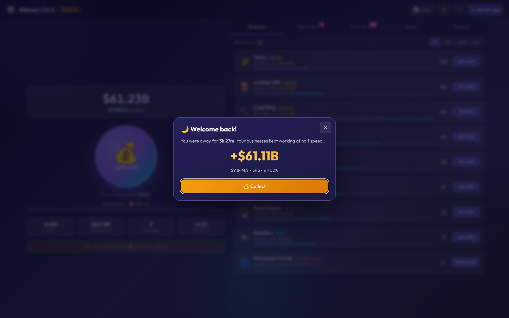<p align="center">🌙 <b>Welcome back</b>: offline earnings</p></td>
<td>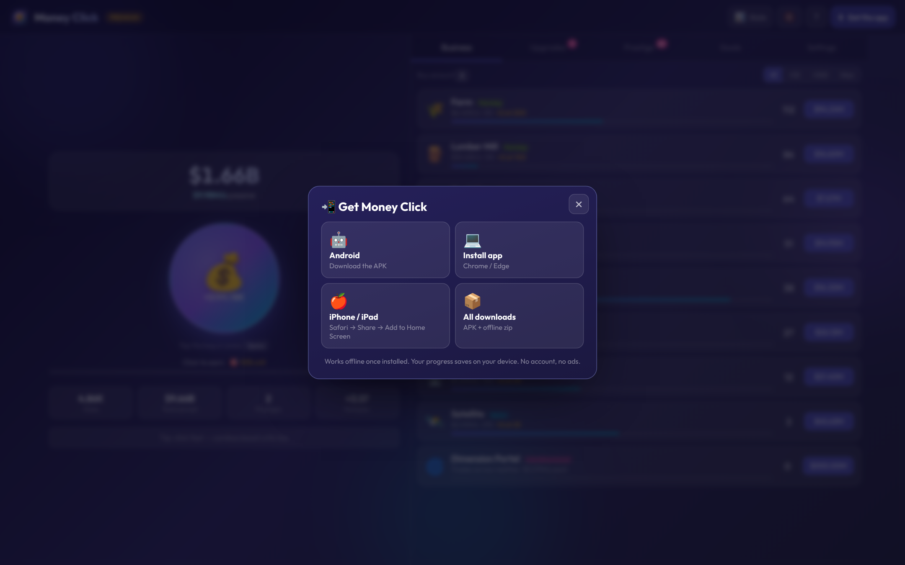<p align="center">📲 <b>Get the app</b>: APK, install, iPhone</p></td>
</tr>
</table>

<p align="center">
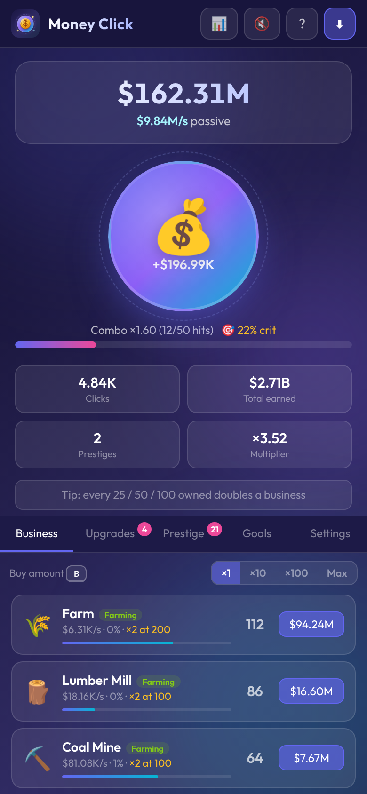
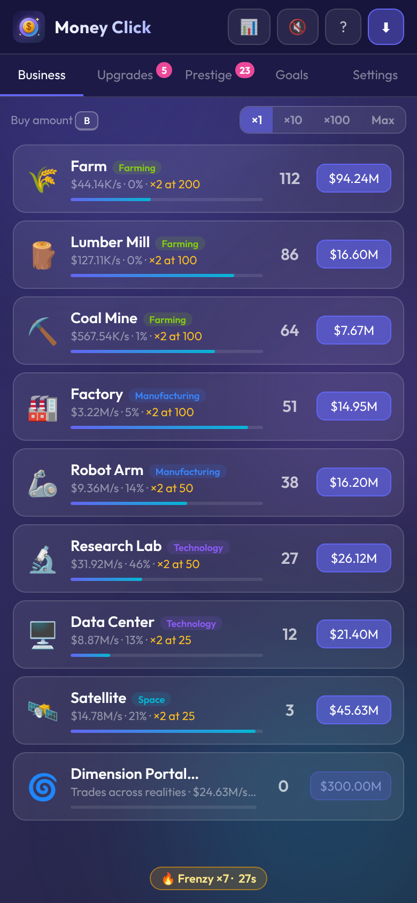
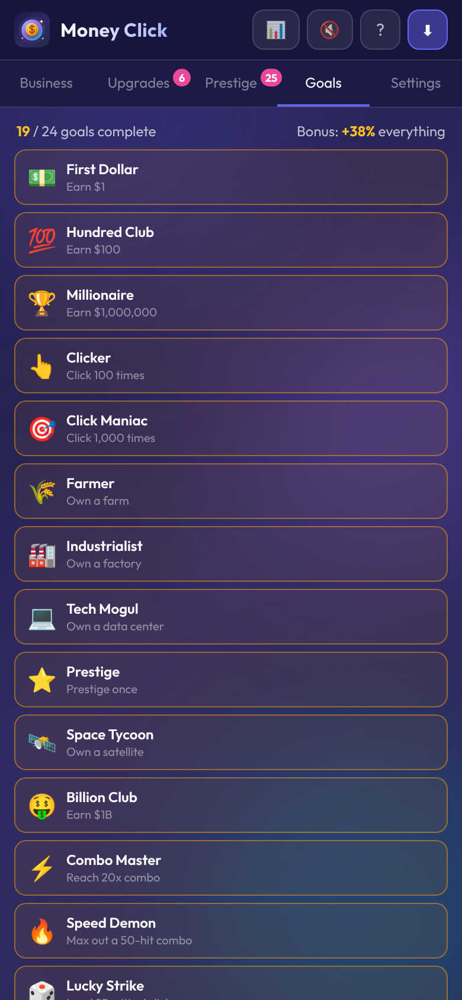
<br><em>📱 Made for phones: tap the bag, sticky tabs, buffs float at the bottom</em>
</p>

## 📥 Get Money Click

| Platform | How |
|---|---|
| 🌐 **Web** | Open **[jaineil32624.github.io/Platformer](https://jaineil32624.github.io/Platformer/)**, nothing to install |
| 🤖 **Android** | Download **[MoneyClick.apk](https://github.com/jaineil32624/Platformer/releases/latest/download/MoneyClick.apk)** → open it → allow *Install unknown apps* if asked |
| 💻 **Windows / Mac / Chromebook** | Open the website in Chrome or Edge → **⬇ Get the app** → **Install** |
| 🍎 **iPhone / iPad** | Open the website in Safari → **Share** → **Add to Home Screen** |
| 📦 **Offline zip** | Grab **MoneyClick-web.zip** from [Releases](https://github.com/jaineil32624/Platformer/releases/latest), unzip, open `index.html` |

> 💡 Works **100% offline** once installed. No account, no ads, no tracking. Your save stays on your device.

## 🛠️ Run it locally

```bash
git clone https://github.com/jaineil32624/Platformer.git
cd Platformer
python3 -m http.server 8000      # then open http://localhost:8000
```

It's a single `index.html`: no build step, no dependencies.

## 🗂️ Project structure

```
Platformer/
├── index.html              💰 the whole game: data, styles, logic, synth audio
├── sw.js                   📴 offline service worker
├── manifest.webmanifest    📲 installable-app manifest
├── icons/                  🖼️ app icons (SVG + PNG + maskable)
├── vendor/                 🔤 Outfit font bundled for offline use
├── docs/screenshots/       📸 images for this README
├── VERSION                 🏷️ bump to publish a new release
└── .github/workflows/
    ├── release.yml         🤖 builds the Android APK + publishes a Release
    └── vendor.yml          ⬇️ refreshes the offline fonts
```

## 🚀 Releasing a new version

Bump the number in `VERSION` and push. GitHub Actions builds the APK and publishes the release automatically:

```bash
echo "2.1.0" > VERSION
git commit -am "Release 2.1.0" && git push
```

## ➕ Adding content

- **Business:** add a row to `BIZ` in `index.html`: `{id:'bank',n:'Bank',em:'🏦',ind:'Finance',rate:…,base:…,cycle:…,unlockAt:…,desc:'…'}`
- **Upgrade:** add to `UPGS` with a `type` of `click`, `biz`, `all`, `crit`, `combo`, `cps` or `gold`
- **Goal:** add to `ACHS` with a `check:g=>…` function

---

<div align="center">

Made with 💜, ☕ and a lot of clicking by **[Jaineil Rana](https://github.com/jaineil32624)**

⭐ *If Money Click made you feel rich for a minute, give it a star!* ⭐

</div>
